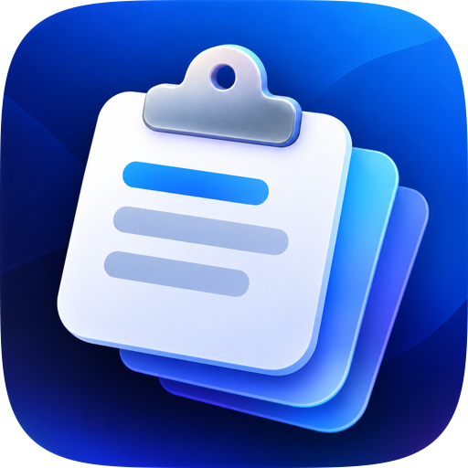
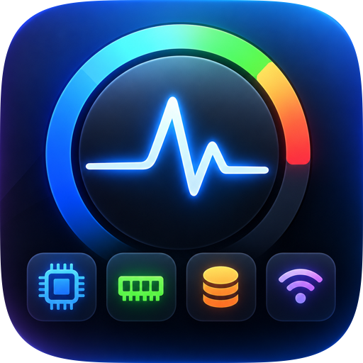
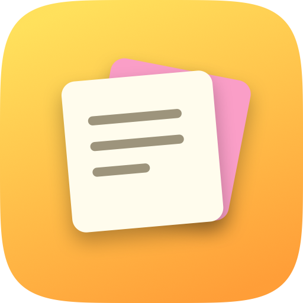

# AppStore

Small, native macOS apps — lightweight, private, and built with SwiftUI.

**Website:** https://mrsagarrb.github.io/AppStore/

| App | What it does | Download | Page |
|---|---|---|---|
|  **ClipMind** | Smart clipboard: remembers text, code, links and images. Search, pin and organise into folders. | [ClipMind.dmg](https://github.com/MrSagarRB/AppStore/releases/download/clipmind-v1.0.0/ClipMind.dmg) | [Landing page](https://mrsagarrb.github.io/AppStore/clipmind/) |
|  **MacPulse** | System monitor in the menu bar: CPU, memory pressure, temperature, battery and network speed. | [MacPulse.dmg](https://github.com/MrSagarRB/AppStore/releases/download/macpulse-v1.0.0/MacPulse.dmg) | [Landing page](https://mrsagarrb.github.io/AppStore/macpulse/) |
|  **QuickNote** | Instant notes: open a tiny floating note with ⌃⌥N. Snippets, temporary thoughts and reminders, saved automatically. | [QuickNote.dmg](https://github.com/MrSagarRB/AppStore/releases/download/quicknote-v1.0.0/QuickNote.dmg) | [Landing page](https://mrsagarrb.github.io/AppStore/quicknote/) |

Requires macOS 14 (Sonoma) or later. Universal binaries (Apple Silicon and Intel).

## Install
Open the `.dmg`, drag the app onto **Applications**, then launch it. The apps are ad-hoc signed and
not notarized yet, so the first launch needs right-click → **Open** → **Open**.

## Repository layout
```
ClipMind/   Swift package + build script for ClipMind
MacPulse/   Swift package + build script for MacPulse
QuickNote/  Swift package + build script for QuickNote
tools/      prepare-icon.swift — turns icon.png into transparent, macOS-shaped icon assets
docs/       Website (GitHub Pages): store page + a landing page per app
```

## Build from source
Requires Xcode command-line tools (Swift 5.9+).
```sh
cd ClipMind && ./build.sh      # → build/ClipMind.app and build/ClipMind.dmg
cd MacPulse && ./build.sh      # → build/MacPulse.app and build/MacPulse.dmg
cd QuickNote && ./build.sh     # → build/QuickNote.app and build/QuickNote.dmg
```
`./build.sh --install` also copies the app into `/Applications`.
